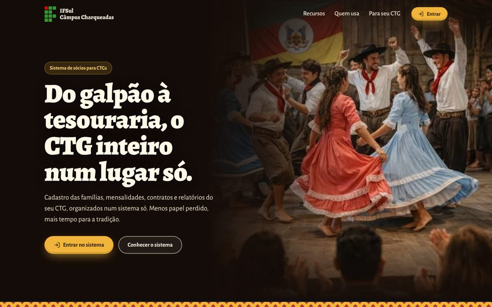
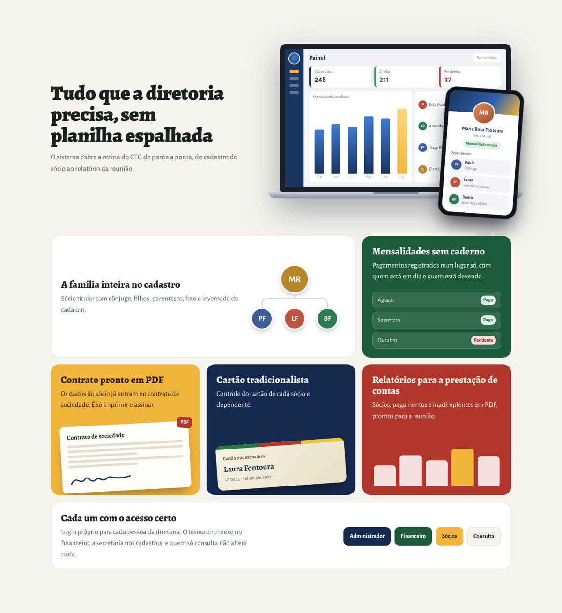
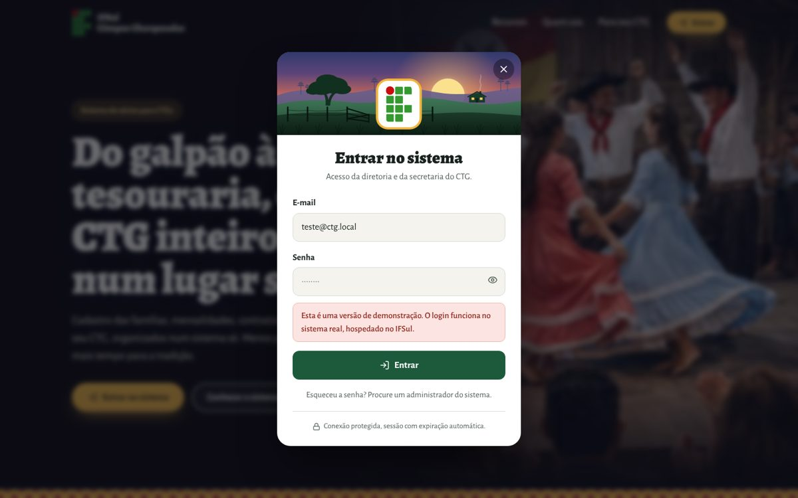
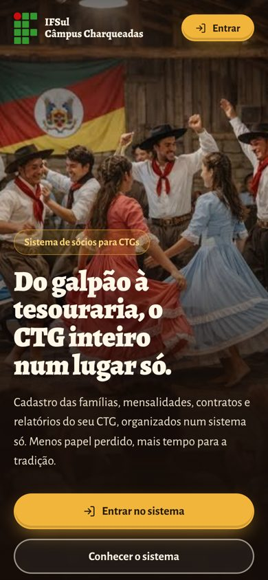

# Sistema de sócios para CTGs · Landing page

**[Ver o site no ar](https://katiadutra.github.io/landing-sistema-socios-ctg/)**

Landing page de divulgação de um sistema de gestão de sócios para Centros de Tradições Gaúchas (CTGs), desenvolvido no projeto de extensão do **IFSul Câmpus Charqueadas**, no curso de **Tecnologia em Sistemas para Internet**.

A página apresenta o sistema para diretorias de CTGs e serve como porta de entrada: o login da diretoria abre num painel sobre a própria landing.



## O que a página mostra

- **Recursos do sistema** com miniaturas de cada tela: cadastro da família do sócio, mensalidades, contrato de sociedade em PDF, cartão tradicionalista, relatórios e perfis de acesso.
- **"Cada um na sua lida"**: abas interativas com o que muda para a patronagem, a tesouraria, a secretaria e os sócios.
- **Passo a passo** de como o sistema entra na rotina do CTG.
- **Convite para outros CTGs** adotarem o sistema.



## Destaques técnicos

- **React 19 + Vite**, componentes próprios e CSS escrito à mão (sem framework de UI), com variáveis de cor e modo escuro.
- **Ilustrações e mockups em SVG e HTML/CSS**, sem imagens pesadas: o pampa ao entardecer e as telas do sistema são código.
- **Login em `<dialog>` nativo**, com foco preso no painel, fechamento pelo Esc e erros exibidos dentro do formulário.
- **Acessibilidade**: abas navegáveis pelo teclado (setas), foco visível, textos alternativos e animações desligadas para quem prefere menos movimento.
- **Responsiva**: no celular, a foto ocupa a tela e o conteúdo se reorganiza em uma coluna.
- **Fontes hospedadas no projeto** (Fontsource), sem depender do Google Fonts.
- **Deploy automático** no GitHub Pages com GitHub Actions a cada push.

<p>
  
  
</p>

## Sobre esta versão

Este repositório é a **versão de portfólio** da landing page. O sistema real tem front-end em React e back-end em PHP com autenticação JWT. Aqui não há back-end, então o login apenas exibe um aviso de demonstração.

No sistema completo, além desta landing page, desenvolvi o cadastro de **dependentes** (com foto e parentesco) e a geração do **contrato de sociedade em PDF**.

## Rodar no seu computador

```bash
npm install
npm run dev
```

## Créditos

- Projeto de extensão do Instituto Federal Sul-rio-grandense (IFSul), Câmpus Charqueadas.
- Curso de Tecnologia em Sistemas para Internet.
- Desenvolvido por [Katia Dutra](https://github.com/KatiaDutra).
